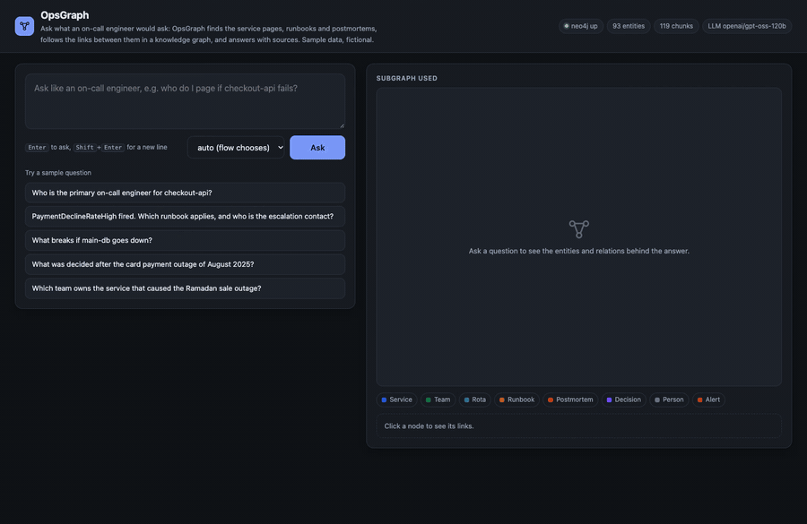
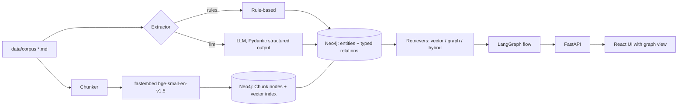
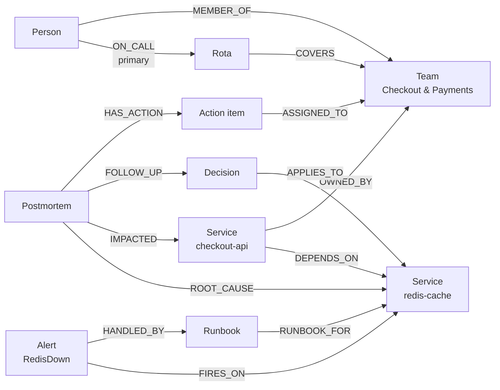
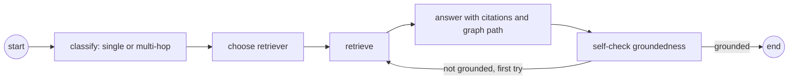
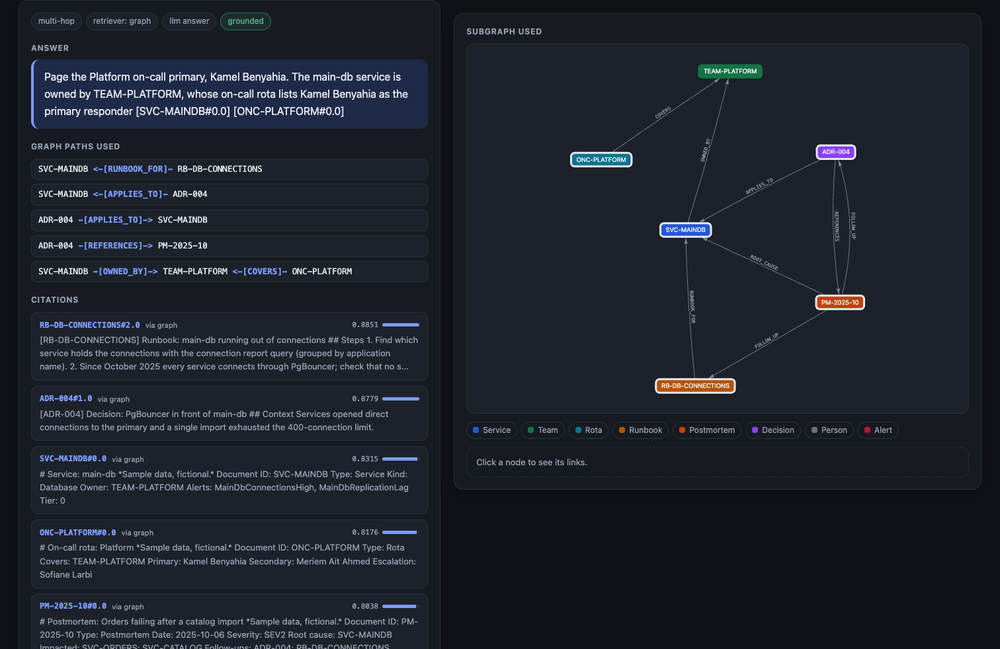
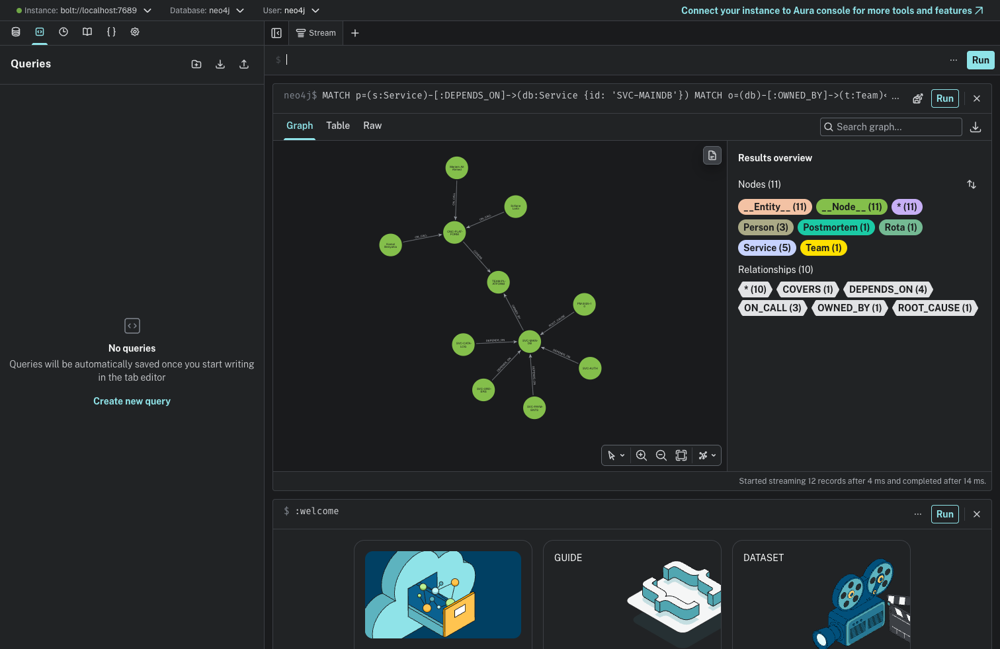
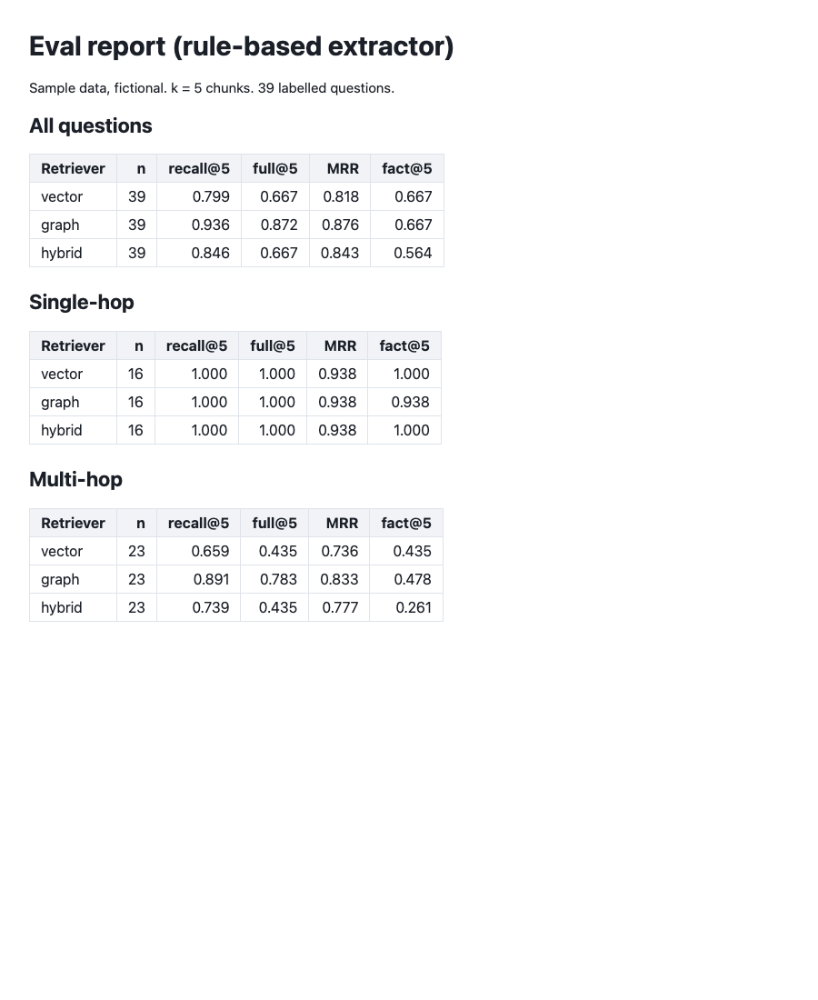

# OpsGraph

[](docs/demo.mp4)

[Watch the demo video (MP4)](docs/demo.mp4)

**OpsGraph answers the questions an on-call engineer asks at 3 a.m.**: *Who do I page if checkout fails? What breaks if the database goes down? This alert fired, which runbook applies? What did we decide after the last outage?* It reads a company's engineering documents (service pages, team pages, on-call rotas, runbooks, postmortems and architecture decisions), turns them into a knowledge graph in Neo4j, and answers with sources and the graph path it followed.

Built with LlamaIndex, Neo4j, LangGraph, FastAPI and a React UI. The documents describe **Tassili Market**, a fictional online shop in Algeria: 36 short documents covering 13 services, 4 teams, 4 on-call rotas, 7 runbooks, 4 postmortems and 4 decisions.

> Sample data, fictional. Every company, person, service and figure in `data/corpus/` was written for this project.

## Why a graph

Most on-call questions need **several documents joined together**, and the question only matches one of them:

- *"Who do I page if main-db runs out of connections?"* The main-db page says it is owned by `TEAM-PLATFORM`. The Platform rota says Kamel Benyahia is primary. The question shares almost no words with the rota.
- *"What breaks if main-db goes down?"* The answer is spread over every service page that lists main-db as a dependency.
- *"What was decided after the card payment outage?"* The postmortem links to the decision record `ADR-003`.

A vector search over chunks finds the page that matches the words and often misses the rest. The graph stores those links (`DEPENDS_ON`, `OWNED_BY`, `COVERS`, `ON_CALL`, `RUNBOOK_FOR`, `ROOT_CAUSE`, `FOLLOW_UP`, …) explicitly, so retrieval can start at the matching pages, follow the edges to the documents that complete the answer, and show the path:

```
SVC-MAINDB -[OWNED_BY]-> TEAM-PLATFORM <-[COVERS]- ONC-PLATFORM
```

## Architecture



### The graph



Entity types: Service, Team, Rota, Runbook, Postmortem, Decision (the six document types), plus Person, Alert, ActionItem and Date. Every chunk also has `(:Chunk)-[:FROM_DOC]->(document)` and `(:Chunk)-[:MENTIONS]->(entity)` links. The schema is a Pydantic model (`opsgraph/schema.py`) shared by both extractors. Nodes are written through LlamaIndex's `Neo4jPropertyGraphStore`; chunk search uses a Neo4j vector index (over-fetched, then re-scored with exact cosine because the HNSW index is approximate).

### Retrievers

- **vector**: top-k chunks from the Neo4j vector index.
- **graph**: the top 3 vector chunks give seed documents; services, people and alert names in the question are linked as extra seeds (`checkout-api`, `checkout api`, `PaymentDeclineRateHigh`, `Nabil Ferhat`); Cypher expands up to 3 hops over the traversal relations, shortest-path queries connect pairs of named entities, and chunks of the reached documents are ranked by similarity × 0.9 per hop. The question's wording also says what kind of document it wants ("who do I page" → an on-call rota, "what was decided" → a decision, "what breaks" → services), and reached documents of that type get a 1.2× boost. For a document reached through an edge, the header chunk (the metadata the edge was read from) gets a 1.1× boost.
- **hybrid**: reciprocal rank fusion of the vector and graph rankings.

### Query flow (LangGraph)



Single-hop questions go to the vector retriever, multi-hop ones to the graph retriever; an ungrounded answer triggers one wider graph retry. With an LLM configured, classify, answer and self-check call it; without one, classification is a keyword heuristic, the answer is extractive (best-matching sentences, cited) and the groundedness check is lexical. The response says which mode ran.

## Results

Measured on 39 labelled questions (16 single-hop, 23 multi-hop), k = 5 chunks, graph built by the **rule-based extractor**. Retrieval metrics need no LLM. Full report: [docs/eval-report.md](docs/eval-report.md).

| Retriever | recall@5 (all) | full@5 (all) | MRR (all) | recall@5 multi-hop | full@5 multi-hop | fact@5 multi-hop |
|---|---|---|---|---|---|---|
| vector | 0.799 | 0.667 | 0.818 | 0.659 | 0.435 | 0.435 |
| graph | 0.936 | 0.872 | 0.876 | 0.891 | 0.783 | 0.478 |
| hybrid | 0.846 | 0.667 | 0.843 | 0.739 | 0.435 | 0.261 |

- recall@5: share of the gold documents (those needed to answer) found in the top-5 chunks; full@5: share of questions where all gold documents were found; MRR: reciprocal rank of the first gold document; fact@5: the gold fact string appears in the top-5 text.
- On single-hop questions all three reach recall 1.000. The graph retriever's gain is on multi-hop questions: it finds every needed document for 78% of them, against 43% for vector search.
- The intent boost matters: without it, the graph retriever reached 0.764 multi-hop recall and 0.522 full coverage. Hub services such as main-db reach about ten documents within two hops, and the one that answers "who do I page" (the rota) ranked just outside the top 5.
- Hybrid now trails graph: fusing with the weaker vector ranking pushes graph-only documents (rotas, decisions) down. That is why the flow sends multi-hop questions to the graph retriever.
- The graph retriever keeps one chunk per document, so it spreads the top 5 over more documents. For a document reached through an edge it prefers the header chunk, where the edge came from (owner, on-call names): that took multi-hop recall from 0.870 to 0.891 and full coverage from 0.739 to 0.783, but a fact written in the body of a decision or runbook can then be left out, so fact@5 did not move (0.478).

### Answers

Retrieval scores the top 5 chunks. The answer step reads those 5 **plus the best-matching other chunk of each retrieved document** (`EVIDENCE_PER_DOC`, default 1). The graph retriever keeps one chunk per document and prefers the header, where the owner and on-call names live, so a rule written in the body of a runbook or decision (for example "never restart the primary") was often missing from what the model read.

Answer eval with `openai/gpt-oss-20b` on Groq, graph retriever, 39 questions, same code with and without the extra evidence. A judge from a different model family (`qwen/qwen3.8-27b`) grades each answer against the gold facts and the context it was given. Reports: [with evidence](evals/report_rules_graph_answers.md), [without](evals/report_answers_no_evidence.md).

| Graph retriever, multi-hop (23) | Without evidence | With evidence |
|---|---|---|
| Gold fact present in the answer context | 0.478 | 0.739 |
| Judge: correct (partial = 0.5) | 0.630 | 0.783 |
| Answer contains the gold fact verbatim | 0.261 | 0.391 |
| Judge: every claim supported by the context | 0.957 | 0.913 |
| Lexical groundedness check passed | 0.783 | 1.000 |

Over all 39 questions the judge score goes from 0.756 to 0.872 (single-hop 0.938 to 1.000). The verbatim metric is strict on purpose (an answer that says "Kamel Benyahia (primary)" counts, "the Platform on-call" does not), so it sits below the judge score.

What is left: in four of the five multi-hop misses the fact never reaches the context (for example the decision record's "45 days" when the graph path stops at the postmortem), so the next step is retrieval, not the prompt. Two answers added a detail the context does not hold, which the judge caught; with more context to read, faithfulness dropped from 0.957 to 0.913. The 120b model was not used for this comparison because its daily token limit on the free tier was reached during the run.

Thresholds are enforced in `tests/test_evals.py`.

## Screenshots

| UI with graph view | Neo4j browser | Eval report |
|---|---|---|
|  |  |  |

## Setup

Requires Docker and Python 3.12.

```bash
cp .env.example .env
```

```bash
docker compose up -d --build          # neo4j (7475 browser / 7688 bolt), api (8001), ui (8090)
```

```bash
curl -X POST localhost:8001/ingest -H 'content-type: application/json' -d '{"extractor":"rules"}'
```

Then open http://localhost:8090 and try the sample questions.

Local development:

```bash
/opt/homebrew/bin/python3.12 -m venv .venv && .venv/bin/pip install -r requirements.txt
docker compose up -d neo4j
.venv/bin/python -m opsgraph.ingest rules      # or: llm
.venv/bin/uvicorn opsgraph.api:app --port 8001
.venv/bin/pytest                               # needs Neo4j reachable
.venv/bin/python -m opsgraph.evaluation --out evals/report_rules_graph.md   # add --llm --judge for answer scores
```

The embedding model (~130 MB) downloads on first use.

### Environment

| Variable | Default | Meaning |
|---|---|---|
| `NEO4J_URI` | `bolt://localhost:7688` | Bolt URL (compose api uses `bolt://neo4j:7687`) |
| `NEO4J_USER` / `NEO4J_PASSWORD` | `neo4j` / `opsgraph-pass` | local development credentials |
| `EMBEDDING_MODEL` | `BAAI/bge-small-en-v1.5` | fastembed model (384 dims) |
| `LLM_BASE_URL` | `https://api.groq.com/openai/v1` | any OpenAI-compatible endpoint (Ollama: `http://localhost:11434/v1`) |
| `LLM_API_KEY` | empty | empty means no LLM: rule extractor, extractive answers |
| `LLM_MODEL` | `openai/gpt-oss-120b` | chat model |
| `LLM_REASONING_EFFORT` | unset | optional, passed through for reasoning models |
| `TOP_K` | `5` | chunks returned |

### API

`GET /health`, `POST /ask` (`question`, `retriever` auto/vector/graph/hybrid, `k`), `GET /graph/entity/{name}` (a document id, alias such as `checkout-api`, person or alert), `POST /ingest` (`extractor` rules/llm, `reset`). `/ask` returns the answer, citations (chunk ids and text), graph paths, the subgraph for the UI, and the flow trace.

## Project layout

```
opsgraph/            Python package
  corpus.py          read and chunk the Markdown documents
  embeddings.py      local fastembed model
  extract/           rule-based and LLM extractors (Pydantic schema in schema.py)
  ingest.py          build the graph: chunks, entities, relations, provenance
  graph.py           Neo4j store wrapper and Cypher query builders
  retrieval.py       vector, graph and hybrid retrievers, question intent
  flow.py            LangGraph query flow
  llm.py             OpenAI-compatible client with rate-limit handling
  api.py             FastAPI service
  evaluation.py      retrieval and answer evals
ui/                  React + Vite + TypeScript web UI (see ui/README.md)
data/corpus/         the 36 fictional documents
evals/               labelled questions and reports
tests/               pytest suite
scripts/             demo recording, screenshots, eval HTML
```

## Key concepts

**Graph RAG in one sentence.** Find the passages that match the question (vector search), then follow the links between documents (graph traversal) to bring in the passages that complete the answer, even when they share no words with the question.

**Entity linking.** Before searching, the question is scanned for names the graph knows: service aliases (`checkout-api`, also written `checkout api`), alert names, people and document ids. Each match becomes a starting point for the traversal, which is how "PaymentDeclineRateHigh fired" leads to its runbook and then to the team's rota.

**Typed relations decide what is traversed.** Only relations that carry meaning between documents are followed (`DEPENDS_ON`, `OWNED_BY`, `COVERS`, …). Dates and action items are leaf facts shared by many documents; following them would connect everything to everything.

**Direction matters, and sometimes it does not.** `DEPENDS_ON` points from the service that needs to the service it needs. "What breaks if main-db goes down?" walks those edges backwards, from main-db to everything that depends on it: the blast radius. The traversal ignores direction, and the path shown to the user keeps the arrows so it can be read.

**Question intent as a ranking signal.** "Who do I page" wants a rota; "what was decided" wants a decision record. Matching a few phrases to a document type and boosting reached documents of that type is cheap, explainable and moved multi-hop full coverage from 0.52 to 0.74 here. It is also the part most tuned to this question set (see Limitations).

**Two extractors, one schema.** The rule extractor reads the metadata block of each document (`Owner:`, `Depends on:`, `Primary:`…) and the action-item lines of postmortems; it is deterministic and free, and CI uses it. The LLM extractor sends the same Pydantic schema as a structured-output contract to any OpenAI-compatible model, for documents without a fixed layout.

**A self-checking flow.** LangGraph runs classify → choose retriever → retrieve → answer → self-check. If the answer is not supported by the retrieved text, the flow retries once with a wider graph search instead of returning an unsupported answer.

**Measure, don't guess.** Every retrieval change is judged on the 39 labelled questions; CI fails if graph retrieval drops below the floors in `tests/test_evals.py`.

## Tests and CI

pytest covers the extractor, the Cypher builders and intent detection, retrieval against Neo4j (on-call path, blast radius, incident to decision), the LangGraph flow (including the retry loop with a scripted model), the API and the eval thresholds; Vitest covers the web UI. Tests that need Neo4j are skipped when it is not reachable. CI (`.github/workflows/ci.yml`) starts a Neo4j service container and runs ruff, pytest, the retrieval evals, the UI typecheck, tests and build, and both docker builds.

## Limitations

- Tiny corpus (36 documents, 39 questions) written by the author on the same schema the extractor reads. The question set, the intent phrases and the corpus were written together, so absolute numbers are optimistic; they are useful to compare retrievers, not to predict results on a real wiki.
- Retrieval parameters (3 hops, 0.9 decay, 3 seeds, 1.2 intent boost, 1.1 header boost) were set by hand, not tuned or cross-validated.
- The on-call rota is a static "primary / secondary / escalation" list; a real rota changes every week and would come from the paging tool's API.
- Without an LLM key the answer step is extractive and the groundedness check is lexical; these are weaker than the LLM path.
- The answer eval is run by hand (it needs an API key and spends daily tokens), not in CI. It uses one judge model; the judge was spot-checked, not validated against human grades.
- No authentication, no incremental ingest, English only.

## License

MIT, see [LICENSE](LICENSE).
